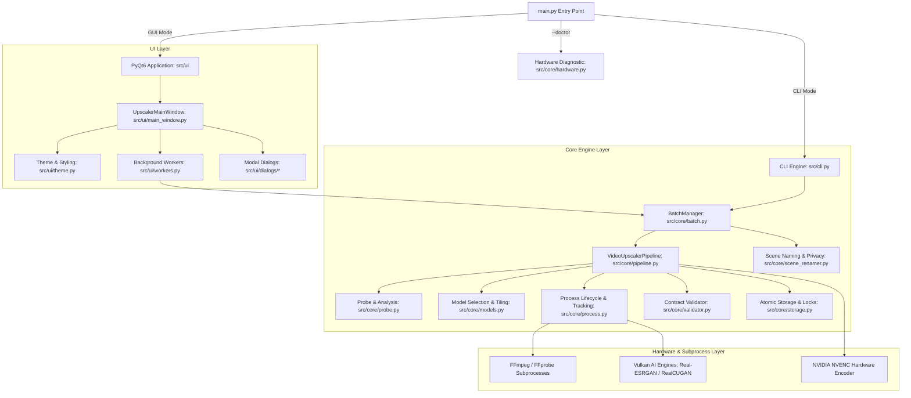
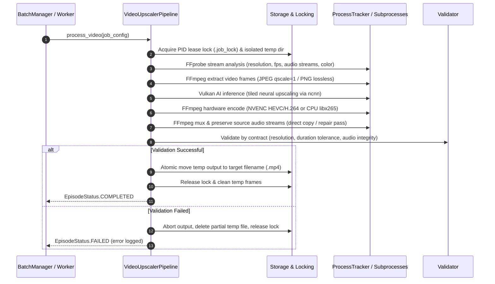

# Video Enhancer 4K — Architecture & Technical Reference

This document provides a comprehensive technical overview of the architecture, design principles, concurrency model, and pipeline lifecycle implemented in **Video Enhancer 4K (Animation & Cartoon Edition)**.

---

## 1. High-Level System Architecture

The application is structured into three decoupled layers: **UI Layer**, **Core Pipeline Engine**, and **External Binaries & Hardware Abstraction**.

---

## 2. Pipeline Lifecycle & Execution Flow

Every video job processed through `VideoUpscalerPipeline` follows a strict 8-stage state machine designed to prevent data corruption, race conditions, and orphaned processes:

### Stage Details

1. **Isolation & PID Lease Locking (`src/core/storage.py`)**:
   - Each job creates an isolated temporary directory in `<temp_root>/<job_id>/`.
   - A lock file (`.job_lock`) containing the current process PID and timestamp prevents concurrent workers or separate application instances from clobbering each other.
   - Stale directory cleanup checks whether the locking PID is actively alive before deleting abandoned folders.

2. **Probe & Rational Metadata Analysis (`src/core/probe.py`)**:
   - Executes `ffprobe` with JSON output formatting.
   - Analyzes rational framerates (e.g., `24000/1001` for 23.976 fps), pixel formats, color range (`tv` vs `pc`), color primaries, and multiple audio stream tracks.

3. **Frame Extraction**:
   - Uses optimized JPEG extraction (`-qscale:v 1`) for a 2x–3x speedup over disk I/O bottlenecks while maintaining 100% perceptual fidelity for 2D animation.
   - Lossless PNG frame I/O is optionally available for archival tasks.

4. **Neural Inference & Dynamic Tiling (`src/core/models.py`)**:
   - Selects optimal scale factors (2x, 3x, 4x) and neural architectures (`realesrgan-x4plus-anime`, `realesr-animevideov3`, `realcugan-pro`, etc.).
   - Computes GPU tile sizes dynamically based on detected VRAM to prevent Vulkan out-of-memory (OOM) driver crashes on high-resolution inputs.

5. **Hardware-Accelerated Video Encoding**:
   - Targets NVIDIA NVENC (`hevc_nvenc` or `h264_nvenc`) with Constant Quality (`-cq 19`), spatial/temporal adaptive quantization (`-spatial-aq 1 -temporal-aq 1`), and high-performance presets (`p1` through `p7`).
   - Automatically falls back to multi-threaded CPU encoding (`libx265` / `libx264`) on systems without NVIDIA hardware.

6. **Audio Stream Preservation & Multiplexing**:
   - Default mode is **Direct Stream Copy** (`-c:a copy`), preserving all original multi-channel audio tracks, bitrates, sample rates, and language tags without re-encoding loss.
   - Includes an automated integrity check: if the muxed audio stream duration diverges from the original or encounters corrupt packets, a secondary repair pass reconstructs the audio container cleanly.

7. **Contract-Based Output Validation (`src/core/validator.py`)**:
   - Verification does not simply check that a file exists on disk.
   - It probes the final file to confirm:
     - Exact target width and height (`width == target_w`, `height == target_h`).
     - Duration matches the source file within an allowed tolerance (`|dur_out - dur_in| <= 1.5s`).
     - At least one valid video stream and matching audio streams exist.
     - Container integrity is intact (no truncated moov atoms).

8. **Atomic Promotion & Privacy Scrubbing (`src/core/storage.py`, `src/core/scene_renamer.py`)**:
   - Temporary outputs are promoted to their final destination via atomic filesystem operations (`os.replace` on the same mount, or staging copy across drives).
   - Container metadata is scrubbed via `-map_metadata -1` to prevent leaking local paths, tool versions, or processing markers into the release file.

---

## 3. Concurrency & Subprocess Architecture

Managing multiple concurrent workers invoking external CLI binaries (FFmpeg, Real-ESRGAN, RealCUGAN) requires rigorous process lifecycle control:

### Windows Process Grouping & Clean Cancellation (`src/core/process.py`)
- Under Windows (`os.name == "nt"`), all spawned child processes are assigned `CREATE_NEW_PROCESS_GROUP`.
- When cancellation is triggered:
  1. `ProcessTracker.cancel()` marks cancellation atomic flags.
  2. It iterates through all active child PIDs and executes `taskkill /F /T /PID <pid>` to terminate the entire process hierarchy (preventing orphaned GPU background engines).
  3. A guarded timeout wait `proc.wait(timeout=2.0)` prevents worker threads from deadlock in unread pipe buffer states.

### Threading Architecture (`src/ui/workers.py`)
- **`UpscaleWorker` (`QThread`)**: Executes batch processing independently of the Qt GUI event loop. Emits PyQt signals (`batch_updated`, `item_updated`, `log_signal`, `finished_signal`) to safely update widgets on the main GUI thread.
- **`ScanWorker` (`QThread`)**: Asynchronously indexes thousands of source files without causing GUI freezes or hitching.
- **`FramePreviewWorker` (`QThread`)**: Extracts and renders single-frame Before/After previews in parallel while the user navigates the table.

---

## 4. Scene / Warez Naming Standards Compliance

The naming engine (`src/core/scene_renamer.py`) strictly adheres to Scene release conventions:

1. **Title Tokenization**: Extracts show name, season, and episode from diverse conventions:
   - Season 1: `S01E01`, `1x01`, `s1e1`, `Episode 1`, `Ep01`
   - Season 2: `S02E01`, `2x01`
   - Specials / TV releases: `TV.S01E01`
2. **Standard Scene Formatting**:
   - Replaces whitespace with dots (`.`).
   - Normalizes tags: `Show.Name.S01E01.Title.2160p.WEB-DL.AAC2.0.H.265-CYLAE.mp4`.
   - Strips illegal filesystem characters and illegal punctuation.
3. **Anonymity & Anti-Leak**:
   - Detects and rejects forbidden markers such as `AI`, `A.I.`, `Real-ESRGAN`, `RealCUGAN`, `Upscaled`.
   - Guarantees the resulting release looks like a native digital master release.

---

## 5. UI Architecture & Responsive 1080p Layout

The desktop interface (`src/ui/main_window.py`) is styled using a custom dark theme (`src/ui/theme.py`) and engineered specifically for Full HD (1920×1080) and higher resolutions:

- **Splitter Architecture**: The main window utilizes a `QSplitter` dividing the left configuration sidebar (380px) and the central queue / logs area (1060px+).
- **Balanced Column Stretch**:
  - `#` : Fixed 48px
  - `Original File` : Stretch mode (~500px on 1080p)
  - `Size` : Fixed 85px
  - `Target Scene Name` : Stretch mode (~500px on 1080p)
  - `Status` : Fixed 115px
  - `Detail / Progress` : Interactive 260px
- **Interactive Before/After Dialog (`src/ui/dialogs/comparison.py`)**:
  - Dual `QScrollArea` panels displaying the source frame alongside the AI upscaled frame.
  - Proportional scroll synchronization (ratio-based `0.0`–`1.0`) with re-entrancy locks to prevent recursive signal loops.
  - Smooth scaling with zoom factors ranging from 25% to 400%.
- **Live Engine Logs (`src/ui/dialogs/logs.py`)**:
  - Color-coded log streams with HTML escaping (`html.escape`) to prevent malformed tags from FFmpeg command lines.
  - Real-time text filtering and auto-scroll controls.

---

## 6. Testing Strategy & Verification

The repository enforces a 100% automated test coverage policy with 94 unit and integration tests across 14 test modules:

| Test Module | Coverage Scope |
| :--- | :--- |
| [`tests/test_audio_preservation.py`](file:///c:/Users/Cylae/Documents/GitHub/Upscaler/tests/test_audio_preservation.py) | Audio probing, stream copying, audio integrity validation, repair pass. |
| [`tests/test_cli.py`](file:///c:/Users/Cylae/Documents/GitHub/Upscaler/tests/test_cli.py) | CLI argument validation, `--doctor`, `--list-presets`, `--export-diagnostics`, `--dry-run`, non-interactive guards. |
| [`tests/test_core_reliability.py`](file:///c:/Users/Cylae/Documents/GitHub/Upscaler/tests/test_core_reliability.py) | Aspect ratio preservation, queue management, pipeline exceptions, model auto-recommendation. |
| [`tests/test_detector.py`](file:///c:/Users/Cylae/Documents/GitHub/Upscaler/tests/test_detector.py) | Hardware detection, GPU VRAM extraction, FFmpeg version detection. |
| [`tests/test_expert_config.py`](file:///c:/Users/Cylae/Documents/GitHub/Upscaler/tests/test_expert_config.py) | Advanced job parameters, metadata sanitization flags, validation contracts. |
| [`tests/test_macos_ui_design.py`](file:///c:/Users/Cylae/Documents/GitHub/Upscaler/tests/test_macos_ui_design.py) | Dark theme tokens, widget styles, padding, layout geometry. |
| [`tests/test_performance.py`](file:///c:/Users/Cylae/Documents/GitHub/Upscaler/tests/test_performance.py) | Thread spec optimization (`load:proc:save`), ETA formatting, local offline model presence. |
| [`tests/test_presets.py`](file:///c:/Users/Cylae/Documents/GitHub/Upscaler/tests/test_presets.py) | Profile definitions (`cartoon_4k_master`, `fast_draft`, `archival`, `lightweight_1080p`, etc.). |
| [`tests/test_preview_and_efficiency.py`](file:///c:/Users/Cylae/Documents/GitHub/Upscaler/tests/test_preview_and_efficiency.py) | NVENC spatial/temporal AQ, clip previews, comparison dialog. |
| [`tests/test_privacy.py`](file:///c:/Users/Cylae/Documents/GitHub/Upscaler/tests/test_privacy.py) | Forbidden marker detection, privacy scrubbing, `-map_metadata -1` enforcement. |
| [`tests/test_reliability_audit.py`](file:///c:/Users/Cylae/Documents/GitHub/Upscaler/tests/test_reliability_audit.py) | Stable queue item IDs, dimension/duration checks, PID lease locks, atomic safe moves, manifests. |
| [`tests/test_renamer.py`](file:///c:/Users/Cylae/Documents/GitHub/Upscaler/tests/test_renamer.py) | Scene naming rules, episode parsing for multiple seasons, custom config formatting. |
| [`tests/test_ui_dialogs.py`](file:///c:/Users/Cylae/Documents/GitHub/Upscaler/tests/test_ui_dialogs.py) | `PreflightDialog`, `DoctorDialog`, `LogViewerDialog`, `FrameComparisonDialog`. |
| [`tests/test_ui_reliability.py`](file:///c:/Users/Cylae/Documents/GitHub/Upscaler/tests/test_ui_reliability.py) | Table filtering, 1080p responsive distribution, ETA visibility, status pill behaviors. |
